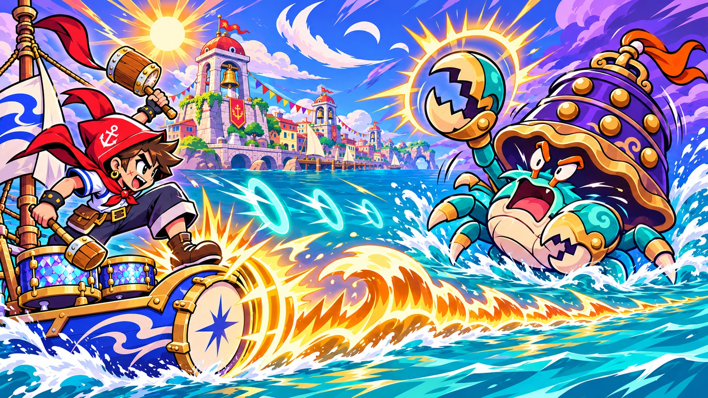

# 潮汐鼓港 · 鼓浪迎击

小鼓船护送庆典灯队穿过港口，拦路的海兽会先用甲壳敲出战鼓。玩家先听清节奏，抓住它收势后的空档，原样打回去。踩底鼓劈出宽阔的金色鼓浪，打军鼓射出短而利落的青色回弹。每次命中都能看见一块敌甲崩开。那只堵住港道的家伙靠什么出招，决定这一战该怎么打。

## 一场战斗怎么打

1. **看出它要出招。** 镜头固定在海面侧视。左边的小鼓船立着绯红兜帽鼓手，右边是对手。敌人先收拢、蓄力，再用鼓声落点示范自己的节奏。
2. **听完再还击。** 示范小节标为「听敌鼓」。换到「还击」时，敌人露出装甲接缝，玩家用相应鼓位复奏。片刻的留白也属于乐句。舞台鼓点、敌人动作与命中窗共用一个时间线。
3. **打掉敌甲并护住船。** 正确命中立即触发相应的出招，弹道负责表现命中，装甲在判定成立时扣除。回应时漏击、空拍敲击或错鼓会让敌人还击，扣一格船体。下一拍仍可继续打。
4. **看结果，快速再战。** 敌甲耗尽时显示破甲胜利；船体耗尽时立刻失败；回合结束仍有敌甲时显示未能击退与剩余甲数。直接重试，回到四拍预备。正式开战前允许试听两块鼓垫。

| 范围 | 内容 |
| --- | --- |
| 首关原型 | 「轰壳蟹」。六块敌甲、三格船体、两次听奏／回应、宽鼓浪和回弹射击、敌人反击与胜负。支持触屏、键盘和罗兰电子鼓。 |
| 概念素材 | 战斗主视觉、三格分镜和角色设定，用于核对剪影、画面距离及出招动作。 |
| 后续规划 | 四章 20 场战斗、耳听难度、设备校准、实体平板验收和 R2 增量内容方案。 |

## 首战 · 轰壳蟹

轰壳蟹是横着堵在海峡里的巨型青绿色螃蟹，背着紫色大钟壳，六片外甲扣在钟边。它的眼睛、蟹钳和钟口在小屏幕上仍能清楚区分。底鼓让甲壳压低，巨钳抬起；军鼓时钳尖快速合拢。紫壳和青肢是敌人主要色块，玩家的绯红兜帽和暖金木船与它们形成反差。海浪线条压低对比，让攻击路径留在画面正中。

### 四小节战斗谱

**84 BPM · 4/4**。每拍约 714.286 ms，每小节约 2.857 秒。四拍预备加四小节约 14.286 秒。下表时间从预备之后的第一个下拍起算，K 为底鼓，S 为军鼓。

| 段落 | 1 | 2 | 3 | 4 | 声音与行动 | 相对时间 |
| --- | --- | --- | --- | --- | --- | --- |
| 四拍预备 | 重提示 | 提示 | 提示 | 提示 | 灯挂铃给拍速，双方就位 | −2.857–0 秒 |
| 1 · 听敌鼓 A | · | S | · | S | 蟹钳以两记较高的短声示范 | 0–2.857 秒 |
| 2 · 还击 A | · | S | · | S | 两次军鼓，青色回弹各打掉一块甲 | 2.857–5.714 秒 |
| 3 · 听敌鼓 B | K | S | K | S | 压钟壳与钳击交替，听见两个音区 | 5.714–8.571 秒 |
| 4 · 还击 B | K | S | K | S | 金色宽浪与青色窄射交替，破开余甲 | 8.571–11.429 秒 |

六个计分点约为 **3.571、5.000、8.571、9.286、10.000、10.714 秒**。预备铃与敌人领拍用不同音色。第一段只要一只手，第二段把底鼓加在明晰的第 1、3 拍，第一段练过的军鼓位置继续成立。

### 判定和损伤

- **打对位置与时间。** 同鼓位的绝对误差 ≤42 ms 为「精准」，>42 ms 至 110 ms 为「命中」。两者都打掉一格甲，精准使用更干脆的动作和更集中的击点。一次击打只消耗一个目标。先按时间窗口匹配，所以第 4 小节首拍的合理提前量也能命中。
- **错失反击时机。** 过窗未击中记漏击。回应小节中的空拍、错鼓或重复击打记多击。每次漏击或多击扣一格船体。第三次伤害立即结束战斗，前一拍扣血不阻止下一拍有效输入。听奏阶段的其他输入可发出试听声。
- **回合结果。** 六击清掉敌甲即胜利。到终点仍有甲，即使船体没耗尽也算未能击退。漏一个目标仍应继续打到下一拍，结算给出剩余敌甲、船体、精准、漏击和多击。每次重新开战恢复六甲和三格船体。
- **输入路径。** 底鼓默认 MIDI 35／36、键盘 D，军鼓默认 MIDI 37／38／40、键盘 F。MIDI 使用有效的 Note On，保留罗兰音源的本机发声。触屏在指针按下时响应，键盘滤除长按自动重复。两块打击区可同时触发，为后续同时击打关卡预留。
- **同一时钟。** Web Audio 预约起音，使用 AudioContext 的 getOutputTimestamp 将听到的第一拍对齐浏览器输入时间戳。有效时间窗由下拍和谱面计算。衔接动画、弹道和帧耗时不参与判定。输出时钟不可用时采用设备报告的延迟估算。设备校准后续独立为 16 拍，取有效误差中位数，按输入和音频路径保存，提供可视的手调和归零。

## 卡通战斗语言

| 状态 | 听见什么 | 看见什么 |
| --- | --- | --- |
| 敌人蓄势 | 低的钟壳压响与高的钳尖脆响 | 壳压低后弹起、蟹钳先张开再合。预告发生在敌方，显示「听敌鼓」。 |
| 底鼓攻击 | 船腹低音，保留实体底鼓的起音 | 贴海推进的宽金弧，鼓船短暂后坐，敌甲向上掀。 |
| 军鼓攻击 | 短而清脆的回弹，瞬时结束 | 细青线带折角和两个短尾迹，击碎接缝后就消失。 |
| 敌方反击 | 较短较低的挫音，与提示鼓声分开 | 紫壳卷起暗浪，落到左侧船体；一格船板标记变暗，鼓垫仍可操作。 |
| 通关／失败 | 最后一击后短和弦收束，败局留短落音 | 破甲后露出钟芯，螃蟹退开让出航道；失败保留可读的剩余甲和伤情。 |

轮廓用粗线条和大的弹性形变。平板优先读出**攻击方向、出招方、剩余甲和船体**。颜色用作辅助，底鼓宽弧和军鼓折线可凭形状辨认。作战提示到「听／打」的区分依赖文字、位置和声音。减弱动态时取消晃动、连闪和扩散粒子，用一次轻微的剪影变化和甲片状态变化表达命中。字幕与按键标签保持实色对比，计分与后续输入不受动画影响。

横屏让左右角色均入画，把大鼓垫放在靠下的双手可达位置。竖屏保留一个宽幅战斗画框，上下布置阶段牌和鼓垫。首关鼓垫建议高至少 72 CSS 像素，控制至少 48×48 CSS 像素。常用流程包括退出、重试、连接鼓组。设计阶段验证焦点可见、键盘可启动与重试、控制在设备安全区内。布局样式从预设视口缩放，测试各尺寸的实际可用区域。

[战斗三格分镜](../art/concepts/gameplay-board.webp) · [鼓手和轰壳蟹角色设定](../art/concepts/characters.webp)

## 四章 · 20 场战斗

每个对手暴露不同的弱点，听到同样速度也可能需要完全不同的动作。先把对应技能单独教清楚，再安排合奏。前五场以清楚的固定提示建立信任，后续才加入假动作、力度渐变、换拍和恢复路线。

| 章 | 遭遇 | 怎么打 | 新技能 |
| --- | --- | --- | --- |
| 一 · 出港斗浪 | 1 轰壳蟹 | 复奏两段出招，把六块紫钟甲敲掉 | 反拍与脚手交替 |
| 一 | 2 挥桨鳐 | 桨鳍抬起半拍后露出腹板，敲军鼓截住 | 八分细分后的还击 |
| 一 | 3 泡盔河豚 | 等连鼓中的整拍停顿，让泡盾自行塌下再追击 | 停顿后回拍 |
| 一 | 4 双铰蛤 | 蚌甲两道锁同开，一手一脚同拍才能卸掉 | 双肢合击 |
| 一 | 5 雾袖章鱼 | 开镲扯开雾袖，下一句开头脚合夹住触须 | 开镲和踩合衔接 |
| 二 · 调校火力 | 6 凸阀龟 | 轻敲先让锅炉减压，压力归零才重击出水口 | 轻重控制与顺序 |
| 二 | 7 镜旗虾 | 鼓面打翻盾牌，鼓边的短音打掉旗杆 | 鼓面、鼓边辨识 |
| 二 | 8 三节沙虫 | 从低到高敲三个通鼓追打三节身体，反爬时倒过来 | 通鼓音区换手 |
| 二 | 9 漏沙螺 | 用两次轻触贴住螺口，中间重音打退壳内摆锤 | 十六分音符内的力度变化 |
| 二 | 10 钟帽鲸 | 用叮叮镲守住拉锯节拍，听见顶铃时击镲帽反震 | 镲帽重音与镲面切换 |
| 三 · 雾中拆招 | 11 红潮魟 | 低响时让过假冲锋，高响后踩底鼓顶回 | 留白与抑制误触 |
| 三 | 12 变调旗鱼 | 兵刃高低提示左右通鼓，用相应攻击逼它转向 | 听觉分类与选鼓 |
| 三 | 13 倒映章鱼 | 另一手稳住拍子，把上一拍的幻影延一拍打散 | 维持脉搏时复奏 |
| 三 | 14 无声灯鲨 | 音乐退到海声，两小节保持内在拍速，拦下出雾的背鳍 | 无伴奏稳拍 |
| 三 | 15 回纹海蛇 | 听完整个三音摆尾，把音色次序倒过来还击 | 不改变间隔地变换顺序 |
| 四 · 潮顶群斗 | 16 扛浪螳螂虾 | 听三、三、二的甲钩重音，打中每组换位的钩子 | 4/4 内的 3+3+2 分组 |
| 四 | 17 双轮剑鱼 | 先截直八分突进，再按每拍三分细分拦转向 | 区分 4/4 与 6/8 |
| 四 | 18 螺旋鳗 | 脚守逃生航道，双手用切分在它绕船时击退 | 多肢独立与过门 |
| 四 | 19 缝甲寄居蟹 | 错过甲片后听修补声，认出重开的弱点并接回主线 | 失误后的复位与即兴判断 |
| 四 | 20 潮峰甲舰 | 轮换两名领奏敌人，中段无伴奏换手，最后三肢合击破舰首甲 | 指令切换与完整乐句 |

## 验收与测量

| 项目 | 方法与目标 |
| --- | --- |
| 好玩与可懂 | 5 人以上，其中至少 2 位初学者。观察首次游玩有没有听懂「听敌鼓／还击」区别，能否说出哪种鼓发了哪种攻击，挨打后能否继续。4／5 人应独立打出第二段还击，至少 3／5 人自发重试。记录具体误解点。 |
| 战斗逻辑 | 用独立谱表标出六个输入，覆盖各输入路径、不该扣血的试听阶段、±42／±110 ms 边界、首拍提前、空拍击打、重复、一次漏击、第三次伤害以及重开后的计数。单独验证六击清甲获胜和回合结束仍有甲失败。 |
| 真实输入延迟 | 在目标平板和罗兰模块上采集至少 30 次真实敲击。双声道录音分别取到耳提示音与实体敲击起音，视频同框记录实际接触和第一帧鼓垫亮起。将实测时间差与页面报告对比，记录校准前后中位差、绝对误差 p95、丢击和多击。外部 MIDI 回放通过实际 USB 路径，用以重复测量。虚拟时钟和注入 MIDI 单列为逻辑测试。 |
| 延迟目标 | 有线或内建输出下，校准后误差中位值绝对值 ≤15 ms、绝对误差 p95 ≤35 ms、接触至首帧视觉反馈 p95 ≤50 ms。另查循环 20 分钟、应用切回及输出设备切换。 |
| 布局与动作 | 查 1024×768、768×1024 与 390×844。平板同时可见双方、鼓垫、护甲、船体和退出。逐项检查多点、键盘、旋转、后台恢复、取消与重来。 |
| 帧率 | 目标平板实际运行，测 60 Hz 上活动帧间隔的中位值 ≤16.9 ms、p95 ≤21 ms。区分普通走拍、攻击、反击和结尾的采样区间，同时公布设备、系统、浏览器、分辨率。 |

短动作在 200–350 ms 内缓出，影响结果的状态更新在接收输入时完成。场景用一层缓存底图、一层活动角色与特效，最多 24 个装饰粒子。像素比目标上限 1.5，首屏视觉素材目标 ≤1.5 MiB。帧率吃紧先降装饰粒子、雾与像素比。剧情动画无全屏停顿，声音和输入持续沿主时钟排程。

## Web 发布与内容管理

Godot Compatibility 导出 Web 版本。浏览器桥接 Web MIDI 和 Web Audio，并合成首关的原创音色。Cloudflare Worker 提供 HTTPS 游戏入口与静态小文件，从 R2 读取按固定哈希发布的压缩 WASM。发布验收纳入正常浏览器配置下的打开、四拍预备、有效攻击、敌方反击与重试。正式域名与备用入口分别验证。

后续曲目清单记录版本、节拍号、BPM、每拍网格、起音偏移、提示、目标与出处。音轨、纹理和大演出文件按内容哈希写入 R2，先校验资源再更新清单。旧清单和旧文件保留回滚路径。对使用自定义资源域的曲目启用合理缓存及 CORS，客户端只预读选中关卡所需文件，加载失败可重试。记录音乐和录音授权，压缩编码后重新测量起音偏移。
